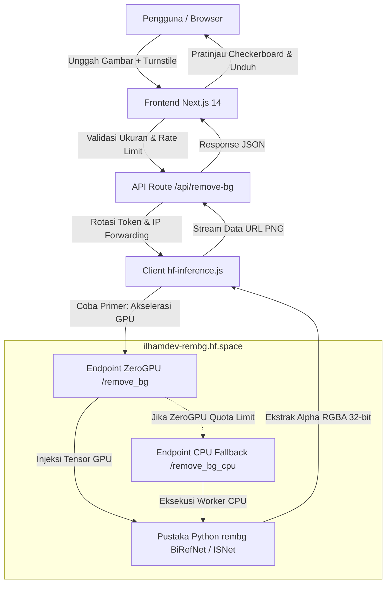

# RemBG: Pemotong Latar Belakang Foto Berbasis AI

Aplikasi web modern untuk menghapus latar belakang foto secara otomatis dengan hasil PNG transparan 32-bit RGBA. Menggabungkan frontend **Next.js 14** bertema **Neubrutalism** dengan backend **Hugging Face ZeroGPU** bertenaga pustaka Python `rembg` (BiRefNet & ISNet).

---

## Pratinjau Tampilan Antarmuka

### 1. Halaman Utama (Neubrutalism Light Mode)


### 2. Pratinjau Interaktif Sebelum & Sesudah (Before/After Slider)
Bandingkan foto asli referensi dengan hasil pemisahan latar belakang riil dari model `BiRefNet Portrait`:


### 3. Editor Kerja Utama (Workspace Pemrosesan)
Area unggah drag-and-drop, seleksi model segmentasi, opsi alpha matting, dan inspeksi hasil:


---

## Fitur Utama

- **Katalog 6 Model Segmentasi AI:**
  - `BiRefNet Portrait`: Khusus potret manusia, mendeteksi helai rambut halus dan lekuk pakaian.
  - `BiRefNet General`: Optimal untuk fotografi produk, katalog e-commerce, dan objek benda padat.
  - `ISNet General`: Pemrosesan cepat dengan batas tepi tegas untuk subjek umum.
  - `ISNet Anime`: Segmentasi spesifik ilustrasi 2D, karakter anime, dan grafik vektor.
  - `U2Net Standard`: Model segmentasi serbaguna dengan stabilitas tinggi.
  - `U2Net Human`: Segmentasi figur manusia ringan untuk kebutuhan cepat.
- **Alpha Matting Tepi Halus:** Opsi erosi piksel tepi dan ambang batas foreground/background untuk helai rambut tipis.
- **Slider Perbandingan Interaktif:** Tuas perbandingan Before/After responsif dengan kendali mouse, sentuhan layar (touch-friendly), dan aksesibilitas keyboard (`input[type="range"]`).
- **Ketahanan Kuota & Arsitektur Dual-Engine:**
  - **ZeroGPU + CPU Fallback:** Inferensi primer dipercepat oleh ZeroGPU (`remove_bg`). Jika kuota GPU limit atau antre, sistem otomatis melakukan failover ke worker CPU (`remove_bg_cpu`) tanpa interupsi.
  - **Multi-Token Rotation (`HF_TOKENS`):** Mendukung load-balancing kuota antar beberapa token akun Hugging Face secara acak.
  - **Rotasi & Forwarding IP Publik:** Melindungi server dari limit IP anonim terpusat dengan meneruskan IP pengunjung asli serta menyediakan generator IP publik acak untuk lingkungan internal.
- **Keamanan & Anti-Spam:**
  - Dilindungi Cloudflare Turnstile tanpa captcha yang mengganggu kenyamanan pengguna.
  - Dilengkapi *in-memory sliding window IP rate limiter* (15 req/menit) untuk mencegah bot flood.
- **Privasi Data Penuh:** Berkas gambar hanya diproses sementara di memori GPU/CPU terisolasi dan langsung dibuang setelah kanal alpha diekstrak. Tidak ada penyimpanan permanen di server.
- **Halaman Error 404 Kustom:** Tampilan 404 berdesain Neubrutalism yang aman tanpa kebocoran informasi internal server.
- **Telemetri Tanpa Pelacak Pribadi:** Modul telemetri aman yang siap dihubungkan dengan Google Analytics (`gtag`) atau Plausible tanpa merekam berkas gambar atau identitas pengguna.

---

## Arsitektur Sistem



---

## Struktur Direktori Proyek

```text
rembg/
├── app.py                     # Entry point backend Gradio, API ZeroGPU & CPU Fallback
├── requirements.txt           # Dependensi Python (rembg, gradio, spaces, pillow)
├── README.md                  # Dokumentasi proyek & konfigurasi HF Space
├── DESIGN.md                  # Panduan desain Neubrutalism (warna, border, tipografi)
├── docs/
│   └── screenshots/           # Tangkapan layar dokumentasi (hero, slider, workspace)
└── frontend/                  # Aplikasi web Next.js 14
    ├── package.json
    ├── next.config.js
    ├── vercel.json            # Konfigurasi deployment Vercel
    ├── .env.example           # Contoh variabel lingkungan
    ├── public/
    │   └── samples/           # Sampel foto sebelum dan sesudah AI
    └── src/
        ├── app/
        │   ├── globals.css    # Sistem desain Neubrutalism lengkap
        │   ├── layout.js      # Metadata, Schema.org JSON-LD, OpenGraph
        │   ├── page.js        # UI utama, dropzone, slider before/after
        │   ├── not-found.js   # Halaman 404 kustom
        │   ├── robots.js      # Generator robots.txt dinamis
        │   ├── sitemap.js     # Generator sitemap.xml dinamis
        │   ├── icon.svg       # Favicon Neubrutalist
        │   └── api/
        │       ├── remove-bg/      # Handler pemrosesan utama + Turnstile
        │       └── demo-remove-bg/ # Handler live demo sampel
        └── lib/
            ├── analytics.js        # Dispatcher telemetri aman privasi
            ├── demo-data.js        # Data URI gambar referensi 512x512 ter-embed
            ├── hf-inference.js     # Klien Hugging Face, token rotation, IP forwarding, failover CPU
            ├── hf-inference.test.js# Pengujian unit modul inferensi
            ├── rate-limit.js       # Sliding-window rate limiter
            └── turnstile.js        # Verifikator server-side Cloudflare Turnstile
```

---

## Panduan Menjalankan Secara Lokal

### 1. Menjalankan Backend Python (Gradio)

Pastikan Python 3.10+ terpasang:

```bash
# Pasang dependensi Python
pip install -r requirements.txt

# Jalankan server Gradio
python app.py
```
Aplikasi backend akan aktif di `http://localhost:7860`.

### 2. Menjalankan Frontend Next.js

Masuk ke folder `frontend`:

```bash
cd frontend

# Pasang dependensi Node.js
npm install

# Buat berkas environment lokal dari template
cp .env.example .env.local

# Jalankan server pengembang
npm run dev
```
Buka browser di `http://localhost:3000`.

### 3. Menjalankan Pengujian Unit

```bash
cd frontend
npm test
```

---

## Konfigurasi Variabel Lingkungan (`frontend/.env.local`)

| Variabel | Keterangan | Nilai Contoh |
|---|---|---|
| `NEXT_PUBLIC_SITE_URL` | Domain kanonikal untuk sitemap dan SEO | `https://rembg.vercel.app` |
| `NEXT_PUBLIC_HF_SPACE_URL` | Alamat backend Hugging Face ZeroGPU | `https://ilhamdev-rembg.hf.space` |
| `HF_TOKEN` | Token akun Hugging Face untuk alokasi kuota ZeroGPU resmi | `hf_xxxxxxxxxxxxxxxxxxxxxxxx` |
| `HF_TOKENS` | Multi-token dipisah koma untuk round-robin/random quota distribution | `hf_token1,hf_token2` |
| `NEXT_PUBLIC_TURNSTILE_SITE_KEY` | Site Key Cloudflare Turnstile | Disediakan Cloudflare |
| `TURNSTILE_SECRET_KEY` | Secret Key Cloudflare Turnstile | Disediakan Cloudflare |
| `NEXT_PUBLIC_GSC_VERIFICATION` | Token verifikasi Google Search Console (opsional) | `google-site-verification-...` |
| `NEXT_PUBLIC_GA_ID` | Google Analytics Measurement ID (opsional) | `G-XXXXXXXXXX` |

> **Catatan Pengujian Lokal:** Jika variabel Turnstile dikosongkan saat pengujian lokal, sistem otomatis menggunakan Dummy Test Key resmi dari Cloudflare (`1x00000000000000000000AA`).

---

## Lisensi & Atribusi

- Pustaka Segmentasi: [danielgatis/rembg](https://github.com/danielgatis/rembg)
- Model BiRefNet: [ZhengPeng7/BiRefNet](https://github.com/ZhengPeng7/BiRefNet)
- Hosting Inferensi: [Hugging Face Spaces (ZeroGPU)](https://huggingface.co/spaces/ilhamdev/rembg)